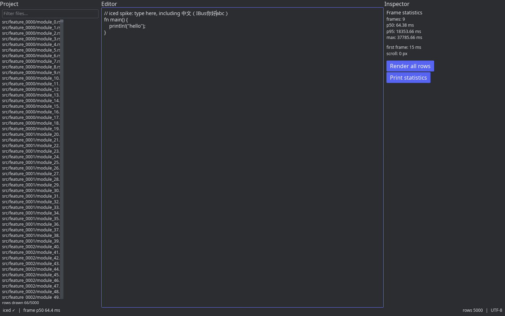

# iced 实测（M0）：能不能在这台无 GPU 机器上跑

对应 [`iced-migration-plan.md`](iced-migration-plan.md) 的 M0：在真机上验证 iced 0.14 的软件渲染、中文输入与帧开销。
代码在 [`spike/iced`](../spike/iced)（独立 crate，不进主 workspace，`cargo build --release` 约 12 s 增量、首次约 6 min）。



## 环境

| 项     | 值                                                                                                                                       |
| ------ | ---------------------------------------------------------------------------------------------------------------------------------------- |
| 机器   | Ubuntu 24.04 VM，ASPEED 虚拟显卡，无 `/dev/dri/renderD*`，GL 走 llvmpipe                                                                 |
| 会话   | X11（:10.0，xrdp），metacity/mutter 窗口管理器                                                                                           |
| iced   | 0.14.0，`default-features = false`，**只开 `tiny-skia`（软件渲染）**，另开 `x11/wayland/advanced-shaping/svg/markdown/highlighter/image` |
| 输入法 | IBus + libpinyin                                                                                                                         |

## 做了什么

一个可运行的窗口：`pane_grid` 三栏（项目列表 20% / 编辑器 56% / 检查器 24%，可拖拽、可调整）、
`text_editor` 可编辑文档、5000 行的可滚动列表、底部状态栏、每帧记录 `view()` 间隔并显示 p50/p95/max。

列表实现了**行窗口化**（只创建视口内的 ~60 行，上下用空白撑开）——因为 iced 的 `scrollable`
本身不做虚拟化，这一点在生产实现里必须自己做（或写成自定义 `Widget`）。

## 结果

### 帧开销（1440×900，软件渲染）

| 场景                                | p50          | p95      | max       | 说明                           |
| ----------------------------------- | ------------ | -------- | --------- | ------------------------------ |
| 只改编辑器（按键）                  | **2.70 ms**  | 2.89 ms  | 4.50 ms   | 一帧只重排版一段文本           |
| 滚动列表（窗口化，62 行/帧）        | **21.98 ms** | 31.01 ms | 81.37 ms  | 每帧重新 shaping 62 行文本     |
| 滚动列表（**不做**窗口化，5000 行） | 65.09 ms     | 93.09 ms | 145.60 ms | 对照组：说明窗口化是必须的     |
| CEF（当前实现，同机同分辨率）       | 20 ms        | 20.1 ms  | 40 ms     | WebKitGTK cairo 路径，整窗光栅 |

结论：**滚动与 CEF 基本持平**（p50 22 vs 20 ms），**按键路径远快于现状**（2.7ms），差距在 p95——
它来自每帧对 60 行文本重新 shaping；生产实现里对行做布局缓存（`lazy` 或自定义 widget 缓存 glyphon 布局）
应能把 p95 压下来。这条列为 M2 的优化项。

### 启动、体积、内存

| 指标               | iced spike             | CEF 版 OpenCLion                               |
| ------------------ | ---------------------- | ---------------------------------------------- |
| 启动到窗口可见     | **171–311 ms**（3 次） | ~400 ms（splash），首次 IPC 1.1–1.9 s          |
| 首帧               | 11–15 ms               | —                                              |
| 二进制             | **20.1 MB**            | 133 MB deb + 272 MB `libcef.so`（安装 439 MB） |
| RSS（列表+编辑器） | **28 MB** 单进程       | **742 MB**（主进程 + zygote + renderer + GPU） |

### 中文输入

| 检查                     | 结果                                                                     |
| ------------------------ | ------------------------------------------------------------------------ |
| ASCII                    | `EditorAction(Edit(Insert('a')))` ×3，正常插入                           |
| IBus 拼音 `nihao` + 空格 | `EditorAction(Edit(Paste("你好")))`，在光标处提交（见截图第一行）        |
| 中日韩字形回退           | `中文（IBus你好abc）` 正常渲染，无豆腐块                                 |
| 组合过程显示             | iced 只交付 `Ime::Commit`（映射成 paste）；**预编辑串（preedit）不显示** |

最后一条是需要在 M2 里补的：真正的编辑器要自己处理 `Ime::Preedit` 才能显示候选串和光标矩形，
`text_editor` 这一层做不到。

## 结论

1. **可行**：iced 0.14 + tiny-skia 在这台无 GPU 的机器上能跑，帧开销与现有 CEF 持平，内存/体积/启动全面占优。
2. **风险点收敛到两处**：软件光栅的天花板（1440×900 约 50 fps，与 CEF 持平，靠减少重绘区域或 GPU 后端改善），
   以及 IME 预编辑显示（iced 0.14 的 `window::Event` 没有 Ime 变体，`Event::Ime` 只在 widget 层交付，
   `text_editor` 只处理 Commit —— 必须自研输入层）。
3. 计划里 M0 的验收（≥50fps、中文提交与光标正确）**通过**；建议继续 M1。

## 复现

```bash
cd spike/iced
cargo build --release
DISPLAY=:10.0 ./target/release/iced-spike          # SPIKE_TRACE=1 打印每条消息与窗口事件
```

界面里「Render all rows / Virtualize list」切换窗口化，「Frozen content」切换内容冻结，
用来复现上面的对照组；`SPIKE_FROZEN=1` 直接以冻结模式启动（脚本化 A/B 用）。
「Print statistics」把当前帧统计打到 stderr。
