# OpenCLion Native Shell

The Tauri/React workbench replaced by a **pure-Rust IDE** built with
[Native Shell (nsh)](https://nsh.dev/zh-CN/docs/). Every pixel of the
workbench — title bar, tool-window stripes, project tree, editor tabs, code
editor, CMake tool window, terminal and status bar — is a native view made by
Rust code. The app links no WebView and no JavaScript engine.

```
native-shell/
├── nsh.json                 app id, window (1400×900), Islands Light tokens
├── Cargo.toml               nsh-core / nsh-base / nsh-platform-* only
├── src/
│   ├── lib.rs               #[component] App, window chrome, shortcuts
│   ├── main.rs              cargo run on the desktop backend
│   ├── model.rs             workspace tree, tabs, search, terminal, signals
│   ├── backend.rs           ide-cmake / ide-vcs / ide-search bridge
│   ├── lsp.rs               clangd documents, diagnostics and status
│   ├── terminal.rs          ide-terminal PTY + nsh Terminal bridge
│   ├── watch.rs             notify-based tree/VCS refresh
│   ├── theme.rs             Islands Light/Dark palette + bundled fonts
│   ├── icons.rs             expui SVG icons inlined as SVG elements
│   └── ui/
│       ├── mod.rs           workbench frame (frame → islands → status bar)
│       ├── titlebar.rs      project widget, configuration, run/debug/search
│       ├── rail.rs          left and right tool-window stripes
│       ├── tree_panel.rs    Project / Commit / Structure / Bookmarks / Search
│       ├── editor_panel.rs  editor tabs + nsh Editor
│       ├── panels.rs        Notifications, Terminal, Problems, Git, CMake…
│       ├── status.rs        breadcrumbs and editor details
│       └── overlay.rs       Quick Open, project menu, Settings, toast
├── assets/                  Inter, JetBrains Mono, expui icons, nsh themes
├── demo/acme-api/           the workspace in the screenshots
└── tests/shell.rs           headless nsh tests (5)
```

## Reusing the main branch backend

The shell is not a mock: it links the same `crates/ide-*` crates the Tauri
backend uses.

| Feature            | Backend                                        | In the shell                                                                                                                                                                                     |
| ------------------ | ---------------------------------------------- | ------------------------------------------------------------------------------------------------------------------------------------------------------------------------------------------------ |
| CMake model        | `ide-cmake` (`load`, File API reply, presets)  | bottom CMake dock with Reload / Build / Run and the target tree; Build builds the selected target without running                                                                                |
| Configure          | `cmake -S . -B build` + `ide_cmake::request`   | click the configuration widget; output streams into the Terminal panel                                                                                                                           |
| Build / Run        | `cmake --build … --target …` + the artifact    | header/bottom Build builds the selected CMake target without running; Run builds then runs it; the target tree is clickable                                                                      |
| Run configurations | `ide-cmake` executables                        | the title-bar widget opens a chooser of CMake executable targets; the selected target drives Run, Debug and the Run tool window                                                                  |
| Git / Commit       | `ide-vcs` (`status`, `stage`, `commit`, `log`) | full-width Git dock (Log/Console/Worktrees), left Commit window with per-file checkboxes, Amend, pre-commit `git diff --check`, message and Commit                                               |
| Find in Files      | `ide-search` (ripgrep engine)                  | Ctrl+Shift+F search panel with parallel, ignore-aware results                                                                                                                                    |
| clangd diagnostics | `ide-lsp` + `ide-language`                     | documents open/change/close on clangd; native editor squiggles and Problems rows; server state in the status bar                                                                                 |
| clangd completion  | `ide-lsp` completion                           | typing (and `.`/`->`/`::`/`<`) opens the native completion list with kinds, details and documentation                                                                                            |
| Go to definition   | `ide-lsp` goto                                 | F12 on a symbol opens the target and places the caret at the definition                                                                                                                          |
| Find / Replace     | nsh Editor search + commands                   | Ctrl+F opens the find bar with match counts and next/previous; Ctrl+H adds replacement with Replace and Replace All                                                                              |
| Format document    | `ide-lsp` `textDocument/formatting`            | Ctrl+Alt+L formats the active document in memory through clangd, keeping the buffer dirty until saved                                                                                            |
| Find Usages        | `ide-lsp` `textDocument/references`            | Alt+F7 lists project references in a Usages tool window; a click opens the file and places the caret                                                                                             |
| Rename symbol      | `ide-lsp` `textDocument/rename`                | Shift+F6 prefills the word at the caret and applies clangd's WorkspaceEdit to open buffers and disk, then refreshes tree and VCS                                                                 |
| Code actions       | `ide-lsp` `textDocument/codeAction`            | Alt+Enter lists quick fixes/refactors; the chosen action applies its WorkspaceEdit or runs its command                                                                                           |
| Type hierarchy     | `ide-lsp` `prepareTypeHierarchy`               | Ctrl+Alt+H lists supertypes/subtypes in a Hierarchy dock; clicking opens the declaration                                                                                                         |
| Terminal           | `ide-terminal` (portable-pty) + nsh `Terminal` | multiple local tabs (`Local`, `Local 2`, + to add, × to close); each tab owns a PTY and raw output log replayed on switch; thin bar cursor after ` ~/…$`                                         |
| Debugging          | `ide-dap` + lldb-dap                           | title-bar bug launches the CMake executable; F9 toggles a breakpoint; Breakpoints list with enable toggles, Condition and Logpoint dialogs; Continue/Step/Stop, frames, expandable locals, Watch |
| File operations    | `std::fs` + native dialogs                     | + / folder creates; right-click offers New File/Folder, Rename file (F2), Delete, Copy Path and Reveal; tabs and tree follow renames                                                             |
| Project tree       | `std::fs` walk + nsh views                     | root on top, 12pt indentation per level, clicking the root collapses/expands the whole project                                                                                                   |
| Title bar          | nsh window controls + native views             | ☰ application menu at the left, custom minimize/maximize/close at the right, project/run widgets in between                                                                                     |
| Status bar         | `ide-vcs` + `/proc/self/statm`                 | current branch and OpenCLion RSS at the right; the branch button opens the Git dock                                                                                                              |
| Bottom dock        | native views + `ide-vcs`/`ide-cmake`           | full-width area showing exactly ONE tool at a time, each with its own header/tab row (Terminal: Local; Git: Log/Console/Worktrees; CMake: actions); no tab strip for other tools                 |
| File watcher       | `notify` + `notify-debouncer-full`             | external creates/renames/deletes rebuild the tree and refresh git status                                                                                                                         |
| Settings           | nsh `Storage` + `serde_json`                   | Appearance/Editor/Keymap/Plugins/Build pages; font size, layout and recent projects persist; Keymap lists shortcuts, Plugins the bundled integrations                                            |

All backend calls run off the engine thread (`nsh blocking`) and report
through signals, so the workbench never stalls while CMake or git works.

## What was ported

| Web frontend (`main`)                                | Native shell                   |
| ---------------------------------------------------- | ------------------------------ |
| `src/workbench/TitleBar.tsx` + `TitleBar.module.css` | `ui/titlebar.rs`               |
| `src/workbench/toolwindows/ToolWindows.tsx`          | `ui/rail.rs`, `ui/panels.rs`   |
| `src/features/project-tree/ProjectView.tsx`          | `ui/tree_panel.rs`             |
| `src/workbench/EditorArea.tsx`, `src/ui/Tabs.tsx`    | `ui/editor_panel.rs`           |
| `src/workbench/StatusBar.tsx`                        | `ui/status.rs`                 |
| `src/ui/Menu.tsx`, `Popup`, `Dialog`                 | `ui/overlay.rs`                |
| `src/styles/tokens.css` Islands Light                | `src/theme.rs::Palette::light` |
| `src/ui/expui/**` icons                              | `assets/icons/*.svg` (inlined) |

The layout follows the CSS constants exactly: 40 pt title bar, 6 pt island
gaps, 10 pt island radius, 234 pt left tool window and a full-width bottom dock;
38 pt tab strip, 22 pt editor rows, 34 pt status bar.

## Run

Requirements: Rust 1.97+, GTK 4.14 development headers, and the `nsh` CLI
0.6 (`curl -fsSL https://nsh.dev/install.sh | sh`).

```sh
cd native-shell
nsh run                 # builds the nsh runner and opens the app
# or, directly on this machine's backend:
cargo run
```

Open another workspace with `OPENCLION_WORKSPACE=/path/to/project`.

On a machine without system GTK headers (this checkout), the app was built
with a local sysroot and `nsh` unpacked under `.tools/`:

```sh
export PATH="$PWD/../.tools/nsh/bin:$PATH"
export CARGO_HOME="$PWD/../.cargo-home"
export PKG_CONFIG_PATH="$PWD/../.sysroot/usr/lib/x86_64-linux-gnu/pkgconfig"
export LIBRARY_PATH="$PWD/../.sysroot/usr/lib/x86_64-linux-gnu"
cargo run
```

## Interactions

| Action              | How                                                  |
| ------------------- | ---------------------------------------------------- |
| Open a file         | click it in Project, or Ctrl+P then type/Enter/click |
| Edit                | type in the NSH editor; the tab shows a modified dot |
| Save                | Ctrl+S                                               |
| Close tab           | Ctrl+W or the tab's ×                                |
| Find in Files       | Ctrl+Shift+F (or the rail magnifier)                 |
| Terminal            | Ctrl+` or the rail terminal icon                     |
| Commit              | Ctrl+K                                               |
| Git dock            | Alt+9, or the bottom-left Git rail button            |
| CMake dock          | Alt+8, or the bottom-left CMake rail button          |
| Project             | Alt+1                                                |
| Toggle tool windows | rail buttons, Ctrl+B (left), Ctrl+J (bottom)         |
| Settings            | title-bar gear                                       |
| Open project        | project name → Open… (system folder picker)          |

## Tests

```sh
cd native-shell
cargo test
```

Eight headless tests run the real nsh engine at 1400×900 and press real
views (LSP, PTY and debug are disabled there so no processes leak): the workbench mounts, a tree file opens in the editor, a folder
expands, Find in Files opens, the terminal panel opens, the CMake window lists
the backend's targets, Commit reads git status, and the New File dialog
opens.

## Theme

The migration is in progress: CMake, git, search, build/run, clangd
diagnostics/completion/goto, the PTY terminal and lldb-dap debugging now use
the main branch backend. File operations cover create/rename/delete with a
context menu, workbench settings persist, and the editor has find/replace.
Debug watch/condition/logpoints and the bottom Git/CMake docks are done;
Remaining main-branch surfaces are the next slices, while
the shell keeps the Islands layout.

Islands Light is the target and the default. `theme.rs` also carries the
Islands Dark palette and the workbench re-colours from it, but the _native
editor and GTK scroll views_ keep their light appearance when the theme is
switched at run time (GTK scroll widgets are created light). Dark mode is
therefore marked "on the roadmap" in Settings rather than shipping a
half-coloured editor.

## Screenshots

|                                                       |                                                 |
| ----------------------------------------------------- | ----------------------------------------------- |
|              | 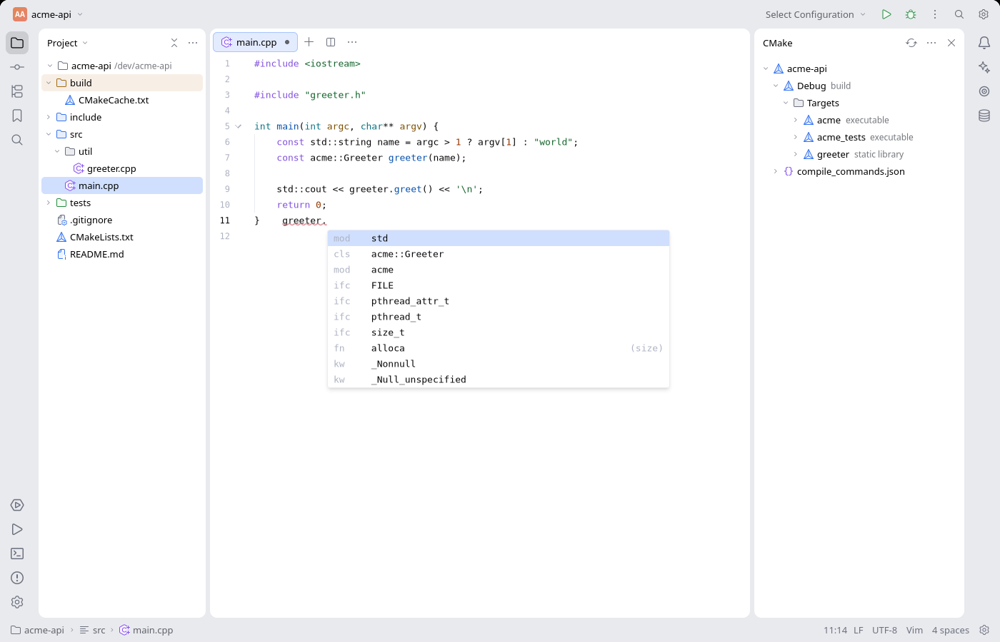 |
| 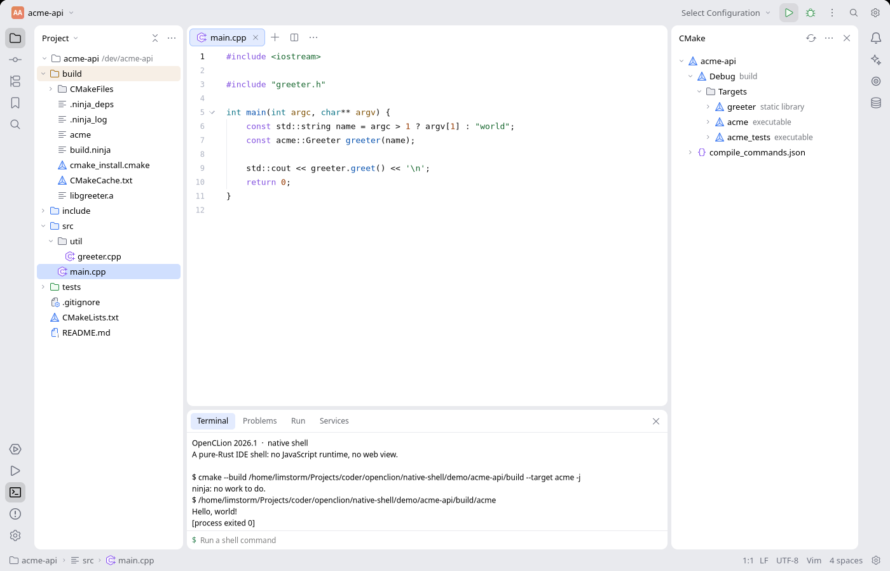     | 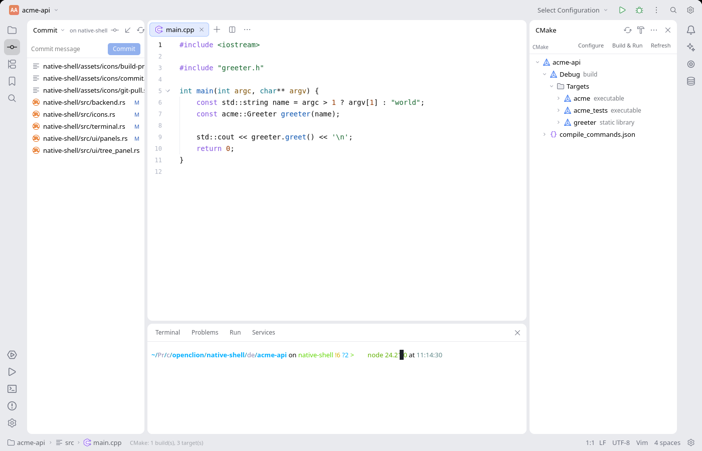         |
|            | 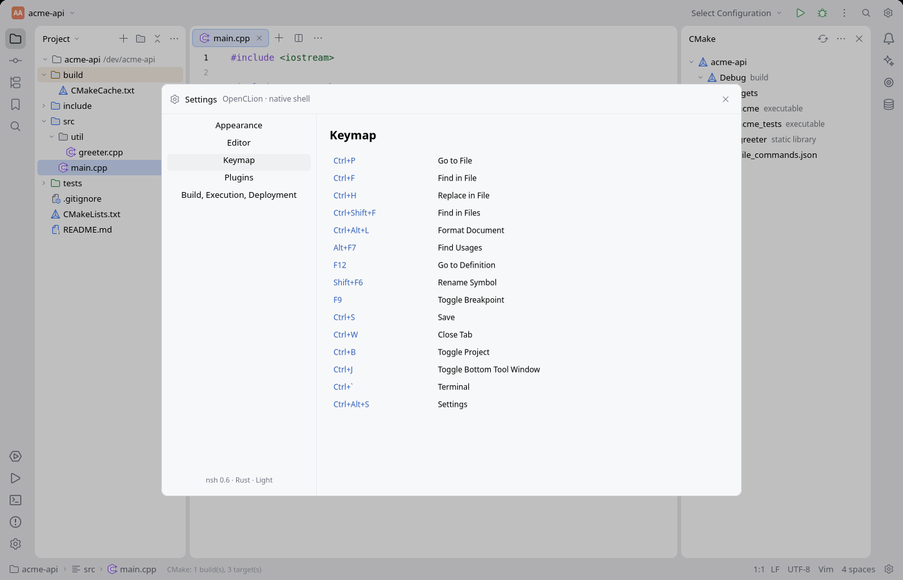         |
| 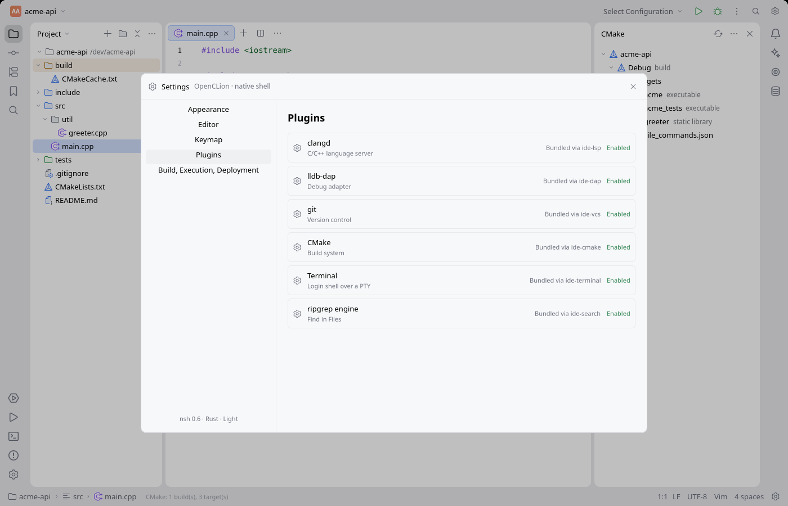             | 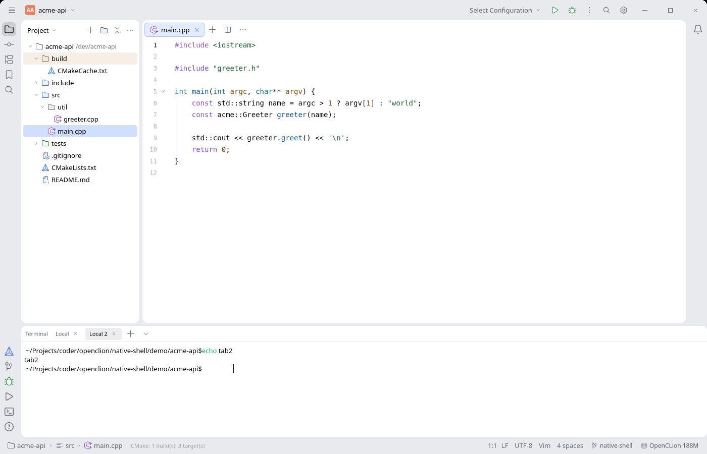          |
| 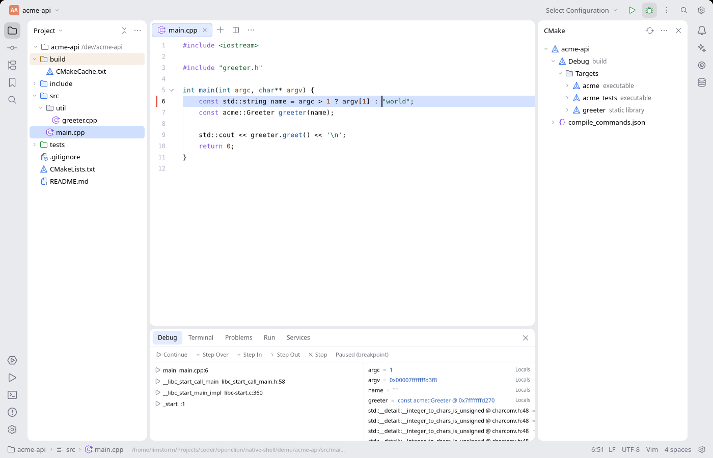             | 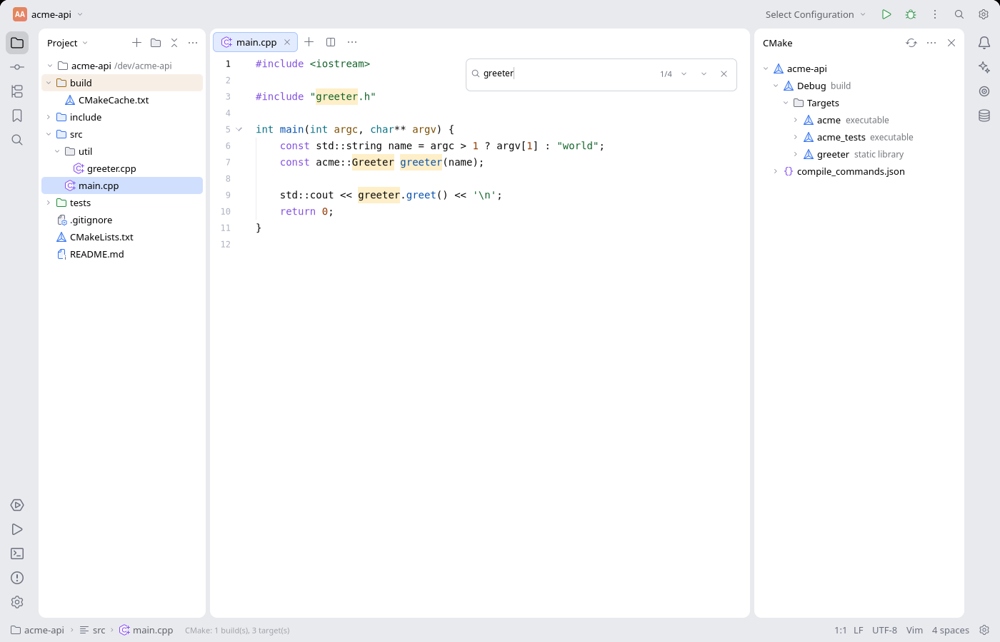         |
| 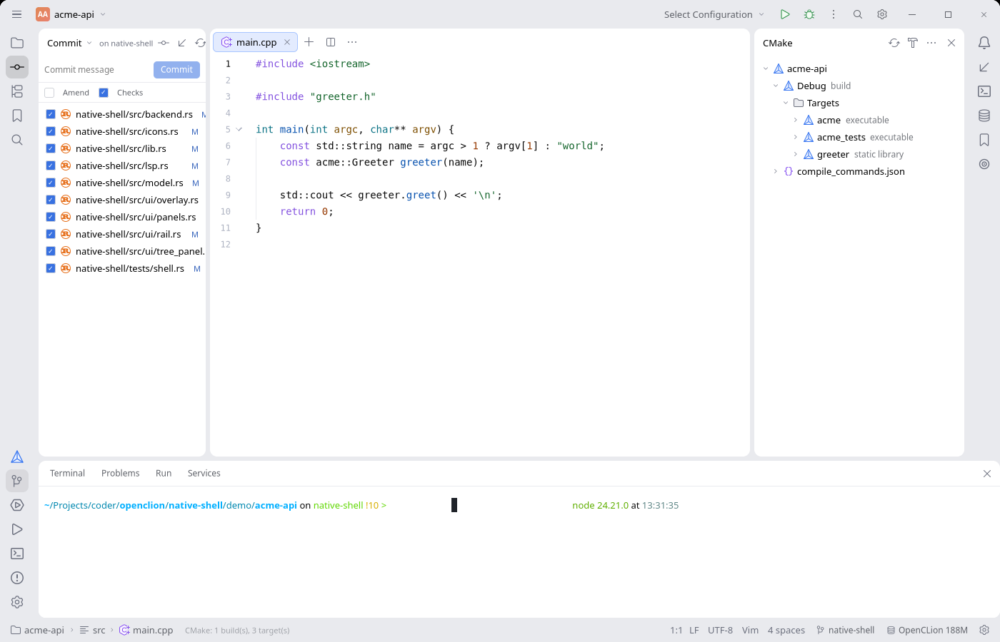 |        |
| 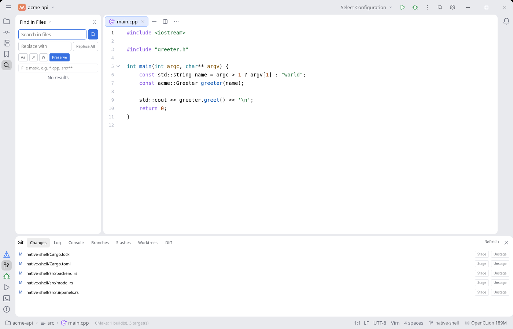                | 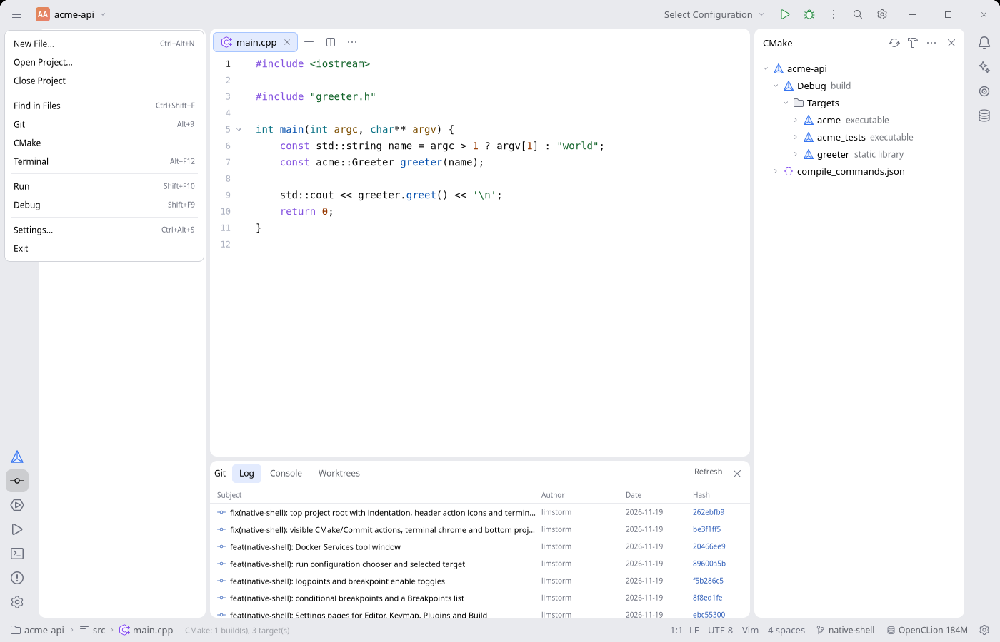         |
