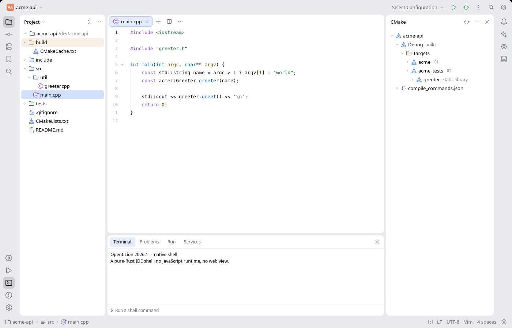
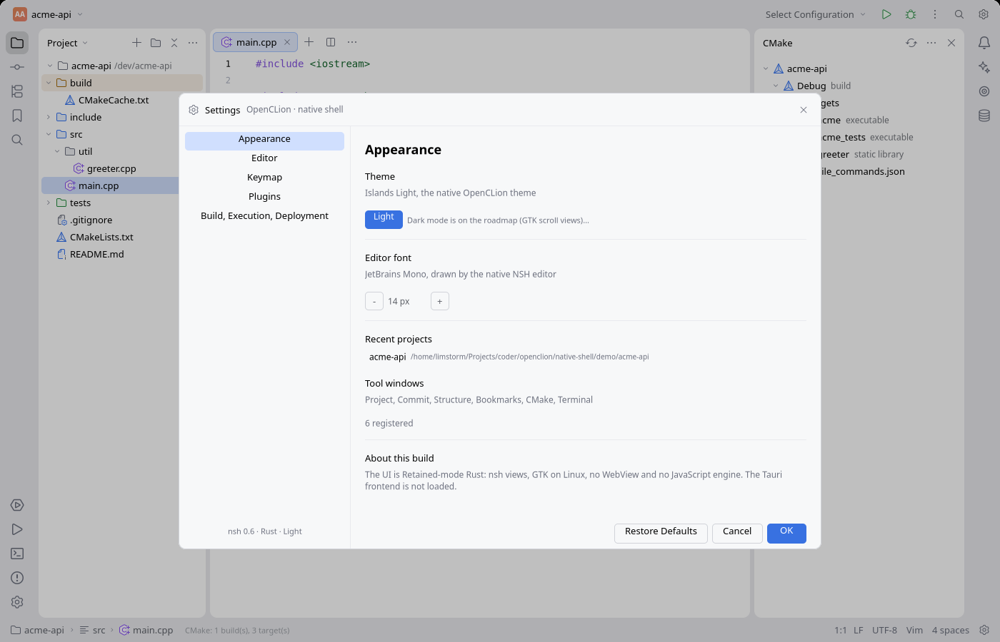

# OpenCLion Native Shell

The Tauri/React workbench replaced by a **pure-Rust IDE** built with
[Native Shell (nsh)](https://nsh.dev/zh-CN/docs/). Every pixel of the
workbench — title bar, tool-window stripes, project tree, editor tabs, code
editor, CMake tool window, terminal and status bar — is a native view made by
Rust code. The app links no WebView and no JavaScript engine.

```
native-shell/
├── nsh.json                 app id, window (1400×900), Islands Light tokens
├── Cargo.toml               nsh-core / nsh-base / nsh-platform-* only
├── src/
│   ├── lib.rs               #[component] App, window chrome, shortcuts
│   ├── main.rs              cargo run on the desktop backend
│   ├── model.rs             workspace tree, tabs, search, terminal, signals
│   ├── backend.rs           ide-cmake / ide-vcs / ide-search bridge
│   ├── lsp.rs               clangd documents, diagnostics and status
│   ├── theme.rs             Islands Light/Dark palette + bundled fonts
│   ├── icons.rs             expui SVG icons inlined as SVG elements
│   └── ui/
│       ├── mod.rs           workbench frame (frame → islands → status bar)
│       ├── titlebar.rs      project widget, configuration, run/debug/search
│       ├── rail.rs          left and right tool-window stripes
│       ├── tree_panel.rs    Project / Commit / Structure / Bookmarks / Search
│       ├── editor_panel.rs  editor tabs + nsh Editor
│       ├── panels.rs        CMake, Notifications, AI, Database, Terminal…
│       ├── status.rs        breadcrumbs and editor details
│       └── overlay.rs       Quick Open, project menu, Settings, toast
├── assets/                  Inter, JetBrains Mono, expui icons, nsh themes
├── demo/acme-api/           the workspace in the screenshots
└── tests/shell.rs           headless nsh tests (5)
```

## Reusing the main branch backend

The shell is not a mock: it links the same `crates/ide-*` crates the Tauri
backend uses.

| Feature       | Backend                                               | In the shell                                                                                                                                |
| ------------- | ----------------------------------------------------- | ------------------------------------------------------------------------------------------------------------------------------------------- |
| CMake model   | `ide-cmake` (`load`, File API reply, presets)         | CMake tool window: builds, targets, kinds, `compile_commands.json`; falls back to `add_executable`/`add_library` before the first configure |
| Configure     | `cmake -S . -B build` + `ide_cmake::request`          | click the configuration widget; output streams into the Terminal panel                                                                      |
| Build / Run   | `cmake --build … --target …` + the artifact           | title-bar green Run; output and the program's stdout land in the Terminal                                                                   |
| Git status    | `ide-vcs` (`Repo::discover`, `status`, `branch_info`) | Commit tool window with branch, changed files and staged/unstaged letters; tree files are tinted by status                                  |
| Find in Files | `ide-search` (ripgrep engine)                         | Ctrl+Shift+F search panel with parallel, ignore-aware results                                                                               |

All backend calls run off the engine thread (`nsh blocking`) and report
through signals, so the workbench never stalls while CMake or git works.

## What was ported

| Web frontend (`main`)                                | Native shell                   |
| ---------------------------------------------------- | ------------------------------ |
| `src/workbench/TitleBar.tsx` + `TitleBar.module.css` | `ui/titlebar.rs`               |
| `src/workbench/toolwindows/ToolWindows.tsx`          | `ui/rail.rs`, `ui/panels.rs`   |
| `src/features/project-tree/ProjectView.tsx`          | `ui/tree_panel.rs`             |
| `src/workbench/EditorArea.tsx`, `src/ui/Tabs.tsx`    | `ui/editor_panel.rs`           |
| `src/workbench/StatusBar.tsx`                        | `ui/status.rs`                 |
| `src/ui/Menu.tsx`, `Popup`, `Dialog`                 | `ui/overlay.rs`                |
| `src/styles/tokens.css` Islands Light                | `src/theme.rs::Palette::light` |
| `src/ui/expui/**` icons                              | `assets/icons/*.svg` (inlined) |

The layout follows the CSS constants exactly: 40 pt title bar, 6 pt island
gaps, 10 pt island radius, 240 pt left tool window, 296 pt CMake tool window,
38 pt tab strip, 22 pt editor rows, 34 pt status bar.

## Run

Requirements: Rust 1.97+, GTK 4.14 development headers, and the `nsh` CLI
0.6 (`curl -fsSL https://nsh.dev/install.sh | sh`).

```sh
cd native-shell
nsh run                 # builds the nsh runner and opens the app
# or, directly on this machine's backend:
cargo run
```

Open another workspace with `OPENCLION_WORKSPACE=/path/to/project`.

On a machine without system GTK headers (this checkout), the app was built
with a local sysroot and `nsh` unpacked under `.tools/`:

```sh
export PATH="$PWD/../.tools/nsh/bin:$PATH"
export CARGO_HOME="$PWD/../.cargo-home"
export PKG_CONFIG_PATH="$PWD/../.sysroot/usr/lib/x86_64-linux-gnu/pkgconfig"
export LIBRARY_PATH="$PWD/../.sysroot/usr/lib/x86_64-linux-gnu"
cargo run
```

## Interactions

| Action              | How                                                  |
| ------------------- | ---------------------------------------------------- |
| Open a file         | click it in Project, or Ctrl+P then type/Enter/click |
| Edit                | type in the NSH editor; the tab shows a modified dot |
| Save                | Ctrl+S                                               |
| Close tab           | Ctrl+W or the tab's ×                                |
| Find in Files       | Ctrl+Shift+F (or the rail magnifier)                 |
| Terminal            | Ctrl+` or the rail terminal icon                     |
| Toggle tool windows | rail buttons, Ctrl+B (left), Ctrl+J (bottom)         |
| Settings            | title-bar gear or the status-bar gear                |
| Open project        | project name → Open… (system folder picker)          |

## Tests

```sh
cd native-shell
cargo test
```

Seven headless tests run the real nsh engine at 1400×900 and press real
views: the workbench mounts, a tree file opens in the editor, a folder
expands, Find in Files opens, the terminal panel opens, the CMake window lists
the backend's targets, and Commit reads git status.

## Theme

The migration is in progress: CMake, git, search, build/run and clangd
diagnostics now use the main branch backend. clangd completion/goto, DAP
debugging, the PTY terminal and the full settings/keymap surface are the next
slices; the shell keeps the Islands layout while each lands.

Islands Light is the target and the default. `theme.rs` also carries the
Islands Dark palette and the workbench re-colours from it, but the _native
editor and GTK scroll views_ keep their light appearance when the theme is
switched at run time (GTK scroll widgets are created light). Dark mode is
therefore marked "on the roadmap" in Settings rather than shipping a
half-coloured editor.

## Screenshots

|                                             |                                             |
| ------------------------------------------- | ------------------------------------------- |
|    |  |
|  |                                             |
